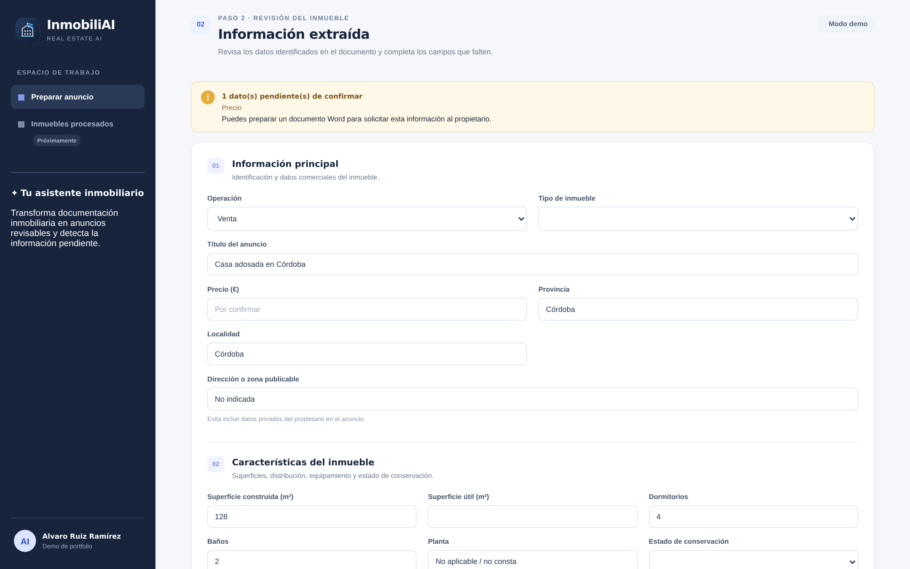
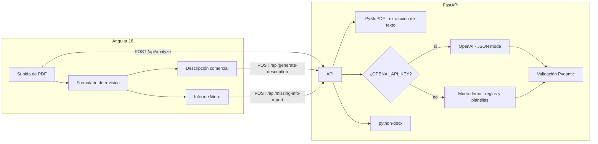

# InmobiliAI · De un PDF inmobiliario a un anuncio revisable con IA

> Este repositorio contiene el **frontend** (Angular). El backend está en [inmobiliAI_backend](https://github.com/Binteak/inmobiliAI_backend).

Herramienta que convierte la documentación de una vivienda (ficha, nota descriptiva o PDF del inmueble) en un **borrador de anuncio revisable**: extrae los datos con un LLM, los valida, señala lo que falta en lugar de inventarlo y redacta la descripción comercial **solo a partir de hechos extraídos**. Si faltan datos, genera un documento Word para pedírselos al propietario.

**Angular 18 · TypeScript · Python · FastAPI · OpenAI API (JSON mode) · Pydantic · PyMuPDF · python-docx · Docker · nginx · Render**

[Demo en vivo](https://inmobiliai-frontend.onrender.com) · [Frontend](https://github.com/Binteak/inmobiliAI_frontend) · [Backend](https://github.com/Binteak/inmobiliAI_backend)



## Qué demuestra este proyecto

- **Extracción estructurada con LLM.** El texto del PDF se envía al modelo en modo JSON (`response_format: json_object`, temperatura 0.2) y la respuesta se valida con un modelo Pydantic (`PropertyDraft`). Si no cumple el esquema, la API devuelve un error claro en lugar de pasar datos rotos al frontend.
- **No inventar datos.** Un dato ausente no se da por falso: queda vacío o como «No consta» y se añade a `missing_fields`. La interfaz muestra cuántos datos están pendientes de confirmar antes de publicar.
- **Descripción basada en hechos.** La descripción comercial sigue una guía de redacción explícita (longitud, estructura, sin adjetivos que no se puedan comprobar, sin vistas, orientación ni servicios inventados, sin precio ni datos de contacto) y se genera solo con los datos que el usuario ha revisado.
- **Defensa frente a prompt injection y datos personales.** El documento se trata siempre como datos, nunca como instrucciones, y el modelo tiene prohibido devolver datos del propietario, DNI, firmas, teléfonos privados o cuentas bancarias.
- **Humano en el bucle.** Todo lo que produce la IA llega a un formulario editable por apartados. El usuario corrige, regenera la descripción con los datos corregidos y copia el anuncio final.
- **Informe de datos pendientes en Word.** Con un clic se genera un `.docx` con una pregunta redactada para cada dato que falta (precio, superficie, certificado energético…), listo para enviar al propietario.
- **Modo demo sin coste.** Sin `OPENAI_API_KEY`, el backend usa un extractor por reglas y un redactor de plantillas, así que la demo funciona sin clave ni gasto. Incluye dos PDFs ficticios que se pueden cargar o descargar desde la propia interfaz.
- **Robustez de la API.** Límite de 12 MB, validación del tipo de archivo, error específico para PDFs escaneados sin texto (422), protección frente a rutas manipuladas al servir los PDFs de ejemplo y CORS restringido al frontend configurado.
- **Listo para desplegar.** Imagen del backend con usuario sin privilegios y healthcheck, build multi-stage del frontend servido con nginx (proxy de `/api` sin configurar CORS) y despliegue en Render. Al abrir la app, el frontend «despierta» el backend con una llamada a `/health`.

## Arquitectura



Flujo de uso:

1. **Documentación.** El usuario sube un PDF (o elige uno de los ejemplos).
2. **Extracción.** El backend extrae el texto, el LLM lo convierte en campos estructurados y Pydantic valida el resultado.
3. **Revisión.** La interfaz muestra los datos por apartados, marca los pendientes y propone una descripción.
4. **Salida.** El usuario corrige, regenera la descripción, copia el anuncio o descarga el Word con los datos que faltan.

## Endpoints

| Método | Ruta | Qué hace |
|---|---|---|
| `GET` | `/health` | Estado de la API e indicador de si la IA real está activa |
| `POST` | `/api/analyze` | Recibe el PDF (`multipart/form-data`, campo `file`) y devuelve los datos estructurados |
| `POST` | `/api/generate-description` | Redacta la descripción a partir de los datos revisados |
| `POST` | `/api/missing-info-report` | Genera el Word con la información pendiente |
| `GET` | `/api/samples` | Lista los PDFs de ejemplo |
| `GET` | `/api/samples/{filename}` | Descarga un PDF de ejemplo |

Documentación interactiva en `/docs` (Swagger UI de FastAPI).

Campos que se extraen: operación, tipo de inmueble, título, precio, provincia, localidad, dirección o zona publicable, superficie construida y útil, dormitorios, baños, planta, ascensor, estado de conservación, terraza, garaje, trastero y calificación energética, además de la lista de hechos detectados y de datos pendientes.

## Arrancar en local

Requisitos: Python 3.11+ y Node 20.19+. El proyecto son dos repositorios; clónalos uno al lado del otro:

```bash
git clone https://github.com/Binteak/inmobiliAI_backend backend
git clone https://github.com/Binteak/inmobiliAI_frontend frontend
```

```bash
# Backend
cd backend
python -m venv .venv
.venv\Scripts\activate          # Windows  (macOS/Linux: source .venv/bin/activate)
pip install -r requirements.txt
copy .env.example .env          # macOS/Linux: cp .env.example .env
uvicorn app.main:app --reload --port 8004   # http://localhost:8004/docs

# Frontend (otra terminal)
cd frontend
npm install
npx ng serve --port 4203        # http://localhost:4203
```

En desarrollo el frontend llama al backend en `http://localhost:8004`, y el backend acepta peticiones del frontend en el puerto 4203 (CORS).

Sin `OPENAI_API_KEY` en `backend/.env` arranca en **modo demo**. Con la clave, usa OpenAI (`OPENAI_MODEL`, por defecto `gpt-4o-mini`). La clave vive solo en el backend y nunca llega al navegador.

| Variable | Para qué sirve |
|---|---|
| `OPENAI_API_KEY` | Activa la IA real. Vacía = modo demo |
| `OPENAI_MODEL` | Modelo de OpenAI (por defecto `gpt-4o-mini`) |
| `FRONTEND_URL` | URL del frontend desplegado, para permitirla en CORS |

### Con Docker

Con los dos repositorios clonados como `backend/` y `frontend/`, crea junto a ellos este `docker-compose.yml`:

```yaml
services:
  backend:
    build: ./backend
    env_file:
      - path: ./backend/.env
        required: false
    restart: unless-stopped

  frontend:
    build: ./frontend
    ports:
      - "8080:80"
    depends_on:
      backend:
        condition: service_healthy
    restart: unless-stopped
```

```bash
docker compose up --build       # http://localhost:8080
```

nginx sirve la aplicación Angular y redirige `/api` y `/health` al backend, así que no hay que configurar CORS ni URLs.

| Fichero | Qué hace |
|---|---|
| `backend/Dockerfile` | Imagen de la API con usuario sin privilegios y healthcheck |
| `frontend/Dockerfile` | Build multi-stage: compila Angular (`--configuration docker`) y lo sirve con nginx |
| `frontend/nginx.conf` | Sirve la SPA y hace de proxy hacia el backend (límite de subida de 15 MB) |

## Estructura

```
backend/
  app/main.py              API FastAPI: lectura de PDF, llamada al LLM, modo demo,
                           validación Pydantic, descripción e informe Word
  samples/                 PDFs de prueba con datos ficticios
  Dockerfile
frontend/
  src/app/app.component.*  Subida, revisión por apartados, descripción e informe
  src/environments/        URL de la API por entorno (local, Docker, Render)
  nginx.conf               Proxy hacia el backend en Docker
  Dockerfile
```

## Próximos pasos

- Tests de backend (pytest) y frontend, y CI en GitHub Actions.
- Separar `main.py` en módulos (extracción, IA, informes) y el componente Angular en componentes por paso.
- OCR para PDFs escaneados.
- Trazabilidad por campo: de qué parte del documento sale cada dato y qué ha corregido el usuario.
- Autenticación, historial de inmuebles procesados y borrado automático de los archivos.

> Los PDFs de ejemplo son ficticios. No subas documentos reales con datos personales a una demo pública. La aplicación prepara el contenido del anuncio para copiarlo; no publica en ningún portal.
